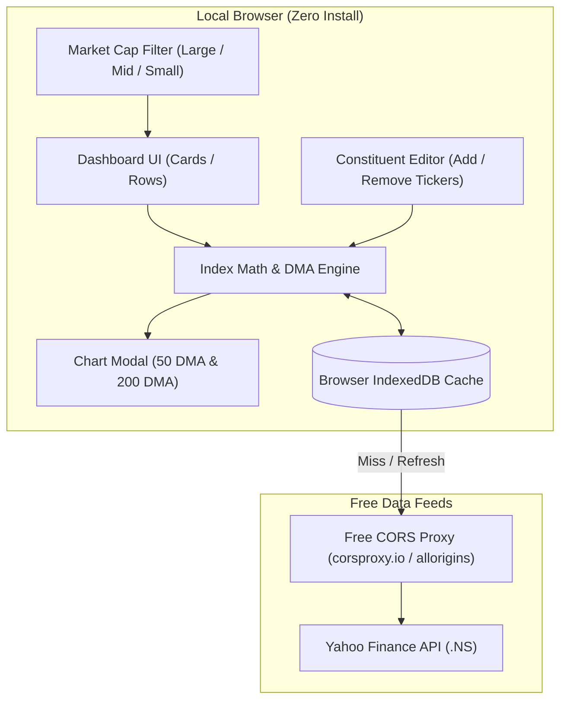

# Indian Stock Market: Industry Trend Tracker — Project Plan

## 1. Executive Summary
A lightweight, zero-maintenance web application to track price trends, momentum, and moving averages (50 DMA & 200 DMA) across 120+ Indian stock market industries filtered by Market Cap (Large, Mid, Small).

---

## 2. Zero-Install Architecture

To fulfill the requirement of **no databases, no Docker, no Node.js, and no Python**, the application is designed as a **Standalone Client-Side Web App (SPA)**:

| Layer | Technology | Rationale |
|---|---|---|
| **Frontend Core** | HTML5 + Modern Vanilla CSS + ES6 JavaScript | Runs natively in any browser by opening `index.html`. Zero runtime dependencies. |
| **Local Storage / DB** | Browser **IndexedDB** & **localStorage** | Stores 2+ years of historical candles, custom user edits (added/removed tickers), and UI state locally on your machine. |
| **Market Data API** | Yahoo Finance Chart API (`.NS` tickers) via free CORS proxies | Free, reliable, and provides 2+ years of daily OHLCV candles without API keys. |
| **Charting Engine** | TradingView Lightweight Charts or Chart.js (via CDN) | High-performance canvas-based financial charts loaded directly in browser. |



---

## 3. Core Modules & Specifications

### Module 1: Pre-Configured Industry Dataset (120+ Industries)
- **Data File (`industries.json`)**: Pre-populated database of 120+ standard NSE industry classifications (e.g., *IT - Software, Private Banks, Public Banks, Auto - 4 Wheelers, Auto Ancillaries, Specialty Chemicals, Defence & Aerospace, Renewable Energy, Pharmaceuticals, Capital Goods, Real Estate, FMCG*, etc.).
- **Constituent Mapping**: Each industry contains representative stocks tagged with:
  - NSE Symbol (e.g., `RELIANCE.NS`, `TCS.NS`, `HAL.NS`)
  - Market Cap Category: **Large Cap**, **Mid Cap**, **Small Cap**
  - Minimum 2 years of listing history verification.

### Module 2: Free Market Data Engine
- **Endpoint**: Yahoo Finance historical chart API (`/v8/finance/chart/{SYMBOL}?range=2y&interval=1d`).
- **CORS Handling**: Multi-proxy failover strategy:
  1. `corsproxy.io/?url=...`
  2. `api.allorigins.win/raw?url=...`
- **Smart Local Caching**:
  - Daily candles are saved to IndexedDB.
  - Subsequent visits load instantly from local storage.
  - One-click "Sync / Refresh Latest Prices" button to fetch today's closing/latest data.

### Module 3: Industry Index & Technical Math
1. **Industry Aggregate Price**:
   - Equal-weighted indexed price (normalized to a base of 100 from 2 years ago or average cumulative returns).
2. **50-Day Moving Average (50 DMA)**:
   $$\text{50 DMA}_t = \frac{1}{50}\sum_{i=0}^{49} \text{Close}_{t-i}$$
3. **200-Day Moving Average (200 DMA)**:
   $$\text{200 DMA}_t = \frac{1}{200}\sum_{i=0}^{199} \text{Close}_{t-i}$$
4. **Trend Indicators & Breadth**:
   - Status: **Bullish** (Price > 50 DMA > 200 DMA), **Neutral**, or **Bearish** (Price < 50 DMA < 200 DMA).
   - Market Breadth: % of constituent stocks currently trading above their 50 DMA.
   - Momentum: 1-Week, 1-Month, 3-Month, and 1-Year percentage returns.

### Module 4: Dashboard UI & Visualizations
- **Filter Bar**:
  - Market Cap selector: `All`, `Large Cap`, `Mid Cap`, `Small Cap`.
  - Search bar: Quick search by industry name or stock symbol.
  - Sort options: By 1M Momentum, Distance from 50 DMA, Market Breadth (% above 50 DMA), Alphabetical.
- **View Modes**:
  - **Cards View**: Grid of visual cards showing industry name, current trend badge, mini sparkline, % above/below 50 & 200 DMA, and constituent count.
  - **Table / Rows View**: Dense financial matrix view for quick scanning and multi-column sorting.
- **Interactive Chart Modal**:
  - Full-screen / popup chart for the selected industry.
  - Plots: Industry Price line, 50 DMA (Gold line), and 200 DMA (Purple line).
  - Crosshair tooltips showing exact date, index value, and DMA levels.
  - Timeframe toggles: 3M, 6M, 1Y, 2Y, Max.

### Module 5: Editable Constituents Manager
- **Edit Modal** on every industry card/row:
  - List of current constituent stocks with their individual latest price and trend.
  - **Delete Action**: Remove any stock with immediate industry re-calculation.
  - **Add Action**: Input an NSE symbol (e.g., `ZOMATO`).
    - Validates ticker existence.
    - Validates minimum **2 years of historical data** (rejects if newly listed < 2 years).
  - **Reset to Defaults**: One-click restore to original factory constituents.
  - **Persistence**: All edits saved locally in IndexedDB/localStorage.

---

## 4. File Structure (Minimal & Clean)

```text
sector trend/
├── index.html              # Main single-page web app entry point
├── styles.css              # Modern dark-mode financial terminal styling
├── app.js                  # UI controllers, view toggle, search & filter logic
├── data-service.js         # API fetcher, CORS proxy handling, IndexedDB cache
├── calculations.js         # Equal-weighted index math, 50 & 200 DMA, breadth
├── industries.json         # Master dataset of 120+ industries & stock mappings
└── PROJECT_PLAN.md         # This project documentation
```

---

## 5. Implementation Phases

1. **Phase 1: Project Setup & Industry Master Data**
   - Build `industries.json` containing 120+ industries mapped with Large, Mid, and Small Cap Indian stocks.
2. **Phase 2: Data Fetching & Local Cache Engine**
   - Implement `data-service.js` with IndexedDB storage, rate-limit throttler, and CORS proxy failover.
3. **Phase 3: Mathematical & Technical Engine**
   - Implement `calculations.js` to compute equal-weighted industry index, 50 DMA, 200 DMA, and breadth.
4. **Phase 4: Dashboard UI (Cards, Rows, & Filters)**
   - Build `index.html` and `styles.css` with dark mode, filters (Large/Mid/Small), search, and view switcher.
5. **Phase 5: Interactive Charts & Constituent Editor**
   - Integrate charting library via CDN with 50/200 DMA overlays.
   - Build Add/Remove stock editor with 2-year history validation and local persistence.
6. **Phase 6: Testing & Verification**
   - Test data fetching, offline caching, editing persistence, and chart rendering in browser.

---

## 6. Review & Feedback Checklist
Please review the plan and confirm:
- [ ] Is the **Equal-Weighted** calculation method aligned with your needs?
- [ ] Do you want the app ready to run by simply opening `index.html` in your browser?
- [ ] Any specific industries or metrics you'd like highlighted first?
